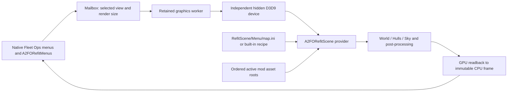

# Menu stages authored in BZN, directed by MMM-style Lua

Assessment: 19 October 2026. Repository: `/home/tamsynn/A2FOHookExtensions`.
This report precedes implementation of a replacement scene loader. Existing
menu DLLs, scene provider, `Menu/map.ini`, render profile and installed maps
remain the baseline. Experimental results are recorded separately below.

## 1. Decision and validation boundary

**Recommend this architecture, with an independent menu-stage runtime.** BZN
should supply placed objects and editor-visible anchors; a separate Lua context
should direct presentation through an explicitly supported MMM-compatible subset.
The existing modern renderer should consume their common scene representation.
Do not load a normal mission, create a gameplay world, or call mission MMM's
engine bindings from the menu's graphics worker.

There are two different feasibility questions:

| Question | Finding |
|---|---|
| Can editor-authored maps be the spatial source? | Yes in principle: the game/editor already represents placed objects, transforms and named mission content. |
| Do our current libraries establish a safe general BZN decoder/writer? | **No.** The available STA64 BZN object/marker reader is heuristic; its converter copies a template unchanged. |
| Can the existing renderer accept arbitrary named views? | The provider accepts a string already. The A2FO host restricts selection to five hard-coded names and needs a separate change. |
| Can mission MMM simply be started in a menu? | **No safe route established.** It expects ScriptInterface, mission/game state and native update callbacks. |
| Is A2FOAchievements an available metadata provider? | The owner confirms it is still planned. Design a future adapter; do not invent current exports or dependencies. |
| Is a complete BZN → modern-renderer + Lua POC validated now? | **Not yet.** BZN object/path/environment serialization and editor round trips are the first gate. |

The correct initial implementation boundary is an isolated lab: conversion
planning, an engine-free Lua scheduling experiment, and detailed renderer timing.
Those components must not be presented as the requested complete BZN POC.
Do not write invented BZN records, rename a JSON/INI file `.bzn`, or use nearest
string/vector scans as a production object loader.

## 2. Current rendered-menu architecture



The main host is [`modules/A2FORefitMenus/menu_scene.cpp`](../modules/A2FORefitMenus/menu_scene.cpp):

- `frame()` begins work lazily when a recognized menu asks for a frame. It
  validates the owning UI thread, chooses a bounded render size, and publishes
  requests. There is no established intro-time preload entry point.
- `start()` captures the resource root and ordered asset roots. `worker_main()`
  owns the backend, handles requests, applies an adaptive frame budget and
  publishes immutable snapshots. The shell does not wait for a render.
- `Backend::create()` makes an independent, never-shown `NOACTIVATE` window,
  creates a D3D9 device/system-memory readback surface and initializes the provider.
  It does not borrow the in-match device. Device changes invalidate GPU resources.
- `Backend::render()` calls `Render3D_MenuScene`, ends the scene, reads the target
  back, then copies pitched rows into `Artwork`. Readback/CPU copying are real
  recurring costs, not BZN-loading work.
- `shutdown()` signals the resident worker without joining under a loader lock.
  Retain this ownership model through any scene-source migration.

The provider is the locally modified Rust `no_std` crate in
[`third_party/armada2-refit/menu-renderer`](../third_party/armada2-refit/menu-renderer/README.md),
pinned to Refit commit `37d60079169b086dba4216fe55e05cd6015d66c0`.
[`src/host.rs`](../third_party/armada2-refit/menu-renderer/src/host.rs)
exports `A2FOScene_ApiVersion`, `A2FOScene_Initialize` and `A2FOScene_SetDevice`.
The host build suppresses executable hooks, gameplay memory reads and game sound
calls. Its API owner is the calling graphics worker, despite an older comment
describing it as a UI thread. Do not attach a mission ScriptInterface here.

[`src/menu/mod.rs`](../third_party/armada2-refit/menu-renderer/src/menu/mod.rs)
contains the source representation and choreography:

| Concern | Current implementation |
|---|---|
| Scene source | `text_of()` reads resource-root `Menu\\map.ini`, else built-in `menus/map.ini`. `draw()` polls for text changes approximately once a second. |
| Objects | `Map::read()` resolves each `[Ship.*]` ODF through `assets::sod_of`, `ScaleSOD` and the SOD index; stores a `ShipDef`. This is a render instance, not a gameplay unit. |
| Groups | `Group::place()` rotates a local point about +Y, then adds the group origin. Ship forward is +Z. |
| Cameras | `[View.*]` supplies eye, target, FOV, sway and departure metadata. View eye/target are transformed through their group. |
| Interpolation | `draw()` retains previous camera state; `smooth(gone / Blend)` interpolates eye, target and FOV toward the requested view. |
| Timing | A private monotonic clock drives bob/roll, sky/planet motion and view arrival. A sufficiently long gap resets the scene clock/camera. It is not the mission clock. |
| Cloak | `cloak_of()` evaluates view entry/exit, group delay/duration/stagger; `Map::shot()` places the cloak fraction in `ShipAt`. Actual hull/cloak rendering remains in the hull renderer. Engine cloak sounds are disabled in the menu host. |
| Warp | `Map::departure()` sorts eligible group ships front-first; computes impulse, stretch, gone/flash state, camera swing/follow, FOV widening and tunnel. `Render3D_MenuWarp` exposes it. **The current A2FO host only resolves/calls MenuScene; a native mission-launch departure is not wired by this host.** |
| Lighting | `[Scene]` key/fill directions and colours become `scene::Lights`; the key also determines sun/gas direction. |
| Planet | One optional `PlanetAt`; class resolves ground/atmosphere, radius, axis, cloud/ground turn and orbit. This is not a general list of BZN planets yet. |
| Nebulae | Each INI region expands to seeded, jittered centres in a rotated ellipse. ODF radius and renderer recipes supply appearance. A region is not one placed nebula object. |
| Passes | Sky, Planet, Ships, Gas, Translucent, Warp; hull setup/flush and the post-processing path are retained. |

[`src/assets/mod.rs`](../third_party/armada2-refit/menu-renderer/src/assets/mod.rs)
indexes ordered roots, resolves ODFs and SODs, decodes DDS/TGA and mip chains,
uploads textures and caches parsed/device resources. Texture decoding and GPU
work are lazy on the first frame and first visit to content.

### Actual view/campaign coupling

The host currently defines `views[]` and `labels[]` for five stock-style choices.
`module.cpp` forwards real clicks on these added scene buttons to `choose(index)`.
Source inspection does **not** establish automatic generic campaign selection:
do not equate selecting a scene tab with receiving an arbitrary campaign ID.
Upstream Refit's UI convention is a reference, not an A2FO campaign API.

## 3. What BZN can replace, and what it cannot replace by itself

The normal editor is the desired authoring tool for actors, physical positions
and orientations. The importer should project map content into a render-only
stage, without constructing AI, teams, pathfinding, economy or network state.

| Data | Intended authority | Present knowledge / limitation |
|---|---|---|
| Ships/stations and arbitrary mod ODF references | BZN objects | Keep the actual ODF identity and active mod root precedence. A valid ODF does not guarantee the menu renderer supports every class. |
| Position and full orientation basis | BZN transform | Preserve pitch/roll as well as heading. Confirm matrix layout and handedness using an asymmetric editor fixture. |
| Team/ownership | BZN metadata | Use as appearance input where required. It must not create gameplay teams. Validate colour lookup; ownership is not an RGB value. |
| Planets | BZN objects + ODF appearance | Multiple planets require extending current one-planet `Shot`/passes; do not silently choose the first. |
| Nebulae | Placed BZN nebula centres | Prefer editor placement; expand legacy procedural INI regions explicitly during conversion. Preserve native type/radius and modern volume/shadow appearance. |
| Background/stars | BZN/environment ODF where decoded | Current inspection detects likely `mbg*`, `env_*`, `stars_*` strings, but does not decode a validated environment record. |
| Lights | Native editor lights where verified | Placed lights can be useful anchors. Exact serialization, direction and colour need calibration. Renderer-specific scatter/exposure remains appearance metadata. |
| Groups/areas | Named anchors, paths or Lua label sets | Old INI groups are transform frames and choreography groups. Neither BZN teams nor player slots are a general substitute. |
| Eye/target anchors and camera rails | Editor-visible marker objects or named paths | Named data exists; a safe A2 path/marker decoder is still missing. |
| FOV, easing, transition seconds, sway | Lua | These are presentation behaviour; do not force them into a position record. |
| Cloak, warp, effects, sequences | Lua acting on stage actors | Render effects, not real mission special weapons or engine simulation. |
| HDR/post/shadow/nebula quality | Existing renderer profiles | Keep render quality orthogonal to spatial authoring. |

### BZN evidence boundary

[`STA64/src/bzn.rs`](/home/tamsynn/OpenSourced-Space-RTS/src/bzn.rs) and
[`docs/bzn-format.md`](/home/tamsynn/OpenSourced-Space-RTS/docs/bzn-format.md)
explicitly describe sample-driven inspection. `object_candidates()` joins
nearby strings, vector fields and matrices; `named_position_markers()` recognizes
particular name patterns. These are useful RE clues, not complete record parsing.
`src/bin/bzn_template_convert.rs` writes `template.data` unchanged. It cannot
serialize this menu scene.

Clean A2 runtime-load navigation evidence at `0x004d2710` and runtime save at
`0x0053c360` identifies parts of the wrapper, including a fixed name/object token
and delegated payload. It does not recover each concrete map object payload.
The detailed field inventory under `reverse_engineering/Armada/source_inventory`
is **Armada I**, not Armada II. Do not transplant it to the live ArmadaL build.
Clean A2 reference addresses are not verified live ArmadaL addresses.

Required decoder work: version/outer-header recognition, bounds-checked typed
streams, class/object framing, labelled object transforms, marker/path records,
environment/light records, references and unknown-class handling. Stock A2 and
FO 3012/3013/3016/MPD4 variants must be tested separately. The existing scoped
KnownMaps metadata adapter is not a complete map-loader compatibility guarantee.

## 4. Camera and group markers

**Recommend named camera and target markers; keep player starts as an optional
convenience.** Eight player slots cannot be the general view catalogue and must
not limit arbitrary campaigns.

Proposed editor labels (examples, not reserved franchise names):

```text
menu_camera_opening
menu_target_opening
menu_camera_hangar
menu_target_hangar
menu_group_fleet_a
```

A small optional marker ODF can use an ordinary editor-placeable class and an
obvious original arrow model. The stage importer recognizes the helper identity,
extracts its transform and excludes it from scene rendering. Do not hide arbitrary
ships merely because their ODF/label resembles a campaign name. Marker ODF/menu
registration and label length need native editor testing before shipping.

Lua binds a public view ID to marker labels. Position and heading come from BZN;
target-marker absence means use the marker's verified forward basis. Lua supplies
FOV, transition/easing and sway. Missing/duplicate markers are explicit validation
errors rather than a first-match guess. Quoted string IDs support names that are
not Lua identifiers. Keep identifiers independent of localized display captions.

Named paths are attractive for eye/target pairs and camera rails because they
avoid helper objects and player-slot limits. Confirm their native record and
editor workflow first; current path detection is heuristic. Do not claim existing
player starts contain FOV or a reliable orientation without calibration.

## 5. MMM-compatible menu Lua

### Reuse conventions, not the mission worker's world

`docs/source-permissions.md` records established permission to use MMM_loader
source in A2FOExtensions. This does not erase third-party notices or grant new
terms. The separately preserved reference archive still has its own pending-use
note; leave that archive unchanged.

The actual checked-in Lua header identifies **Lua 5.1.5**. Its adjacent README
claims a different version, so use the source header/ABI when selecting a VM.
Preserve Lua's embedded copyright/licence notice if embedding that interpreter.

`mmm_loader/Main.cpp`, `Worker.cpp` and `mmm_armada/LuaBinding.cpp` establish:

- ScriptExtendInterface/ScriptInit and the first native input update attach the
  mission worker. Some setup is deliberately delayed to avoid crashes.
- `setupLua()` resolves a mission's map title and `.mmmpack`/`.lua` script.
- Global native game pointers, rule registration and ScriptInterface are part of
  that lifecycle. Starting it in a menu is not justified by these sources.
- Native `workerUpdate` pumps `timer_update`; there is no evidenced global Lua
  `update()` entry point. The current registration opens base/package/table/
  string/math/debug; it does not register coroutine, IO or OS libraries.
- `TimerWrapperBinding.cpp` exposes `Timer(id, interval, Timer.State.Started)`,
  `:hook(id, table, function, arguments)`, start/stop/unhook, interval/repeats/state,
  and static lookup/stop-all. These are the conventions to preserve first.

Use a **separate, menu-owned Lua VM** with a documented subset of this interface.
It must not share Lua states, registry references or C++ objects across the MMM
loader ABI, and must never resolve raw gameplay engine addresses. If the future
MMM project provides an engine-free scheduler, use that as the common backend.
Otherwise implement the small adapter explicitly and test compatibility claims.

Proposed extension namespace (not current MMM exports):

```lua
-- Positions come from BZN labels, not numeric coordinates in this file.
Menu.Camera.define("opening", "menu_camera_opening", "menu_target_opening", 40)
Menu.Camera.define("hangar", "menu_camera_hangar", "menu_target_hangar", 42)
Menu.Camera.gotoView("opening")

local visit = Timer("visit_hangar", 4.0, Timer.State.Started)
visit:hook("visit_hangar_hook", nil, function(timerObject, hook)
    Menu.Camera.panTo("hangar", 2.0)
    timerObject:stop()
end, nil)
```

First capabilities: named camera selection/transition/FOV and timer callbacks;
then appearance-only cloak fractions, actor transforms and renderer warp effects.
Weapon firing, sound, projectiles, animation control and arbitrary effects are
additional capabilities, not automatically inherited from mission MMM. Avoid
promising `scene.wait`/coroutine semantics without implementing/registering them.

Give the VM a bounded allocator, instruction budget and bounded command queue;
open only required libraries. Disable file/process/DLL loading, package searchers,
debug escape paths and raw engine handles. A callback error stops the script or
keeps the last valid stage; it cannot block the menu. Never invoke Lua from a
native window procedure. Queue copied identifiers to the owning scene thread.

## 6. Generic campaigns and A2FOAchievements

The owner confirms **A2FOAchievements is planned, not yet added**. There is no
current campaign export to bind. Its future schema should expose an opaque,
stable campaign ID and optionally a `menuView` string. Save/progress IDs and
localized captions must remain separate.

The renderer needs only `selectView(viewName)`; the menu/campaign adapter resolves
`campaignId -> viewName`. Missing IDs select the package default. The adapter must
eventually receive actual selection/launch events, not scrape localized captions
or infer race names. A small metadata map is legitimate while Achievements is
absent. The existing five debug scene tabs can remain a legacy compatibility UI
until a generic view catalogue replaces them.

Examples such as `empire -> throne_room` and `minbari -> fleet_overview` should be
configuration/script data. Do not add franchise tests or renderer branches.

## 7. Files and modder workflow

Proposed package under the existing scene resource root:

```text
RefitScene/
  Menu/
    menu.bzn
    menu.lua                optional for a static scene
    menu.cfg                optional metadata only
  Render3D.ini              existing renderer-quality profile
```

The filenames above are proposed; none is an implemented loader contract yet.
Resolve a custom package through the active extension/mod roots, then a shipped
default. Keep assets resolved through the existing ordered roots. Do not scan
sibling mods or take an ODF from an unrelated total conversion.

An optional configuration may name the BZN/script, default view, schema/version,
compatibility profile and campaign/view mappings. Prefer conventional filenames
and Lua view definitions so most mods need no CFG. Do **not** add per-ship `At`,
per-camera eye/target coordinates, group placement or choreography to it.

Desired workflow:

1. Open the dedicated BZN in the normal editor, within the intended mod.
2. Place actors, environment and named camera/target helpers or verified paths.
3. Save; keep native editor metadata and any required companions.
4. Edit Lua for timing, view bindings and presentation effects.
5. Add optional campaign/view metadata; launch normally.
6. In developer mode, reload Lua/view metadata at a safe frame boundary. Replace
   BZN only after a complete new stage validates; preserve the previous stage on
   failure. File watching does not imply safe in-place GPU-resource mutation.

## 8. Compatibility, failure handling and quality

Select and validate a **whole package**, not independently mixed files:

```text
valid active-mod Menu/menu.bzn (+ optional matching script/metadata)
  -> valid shipped default BZN package
  -> existing legacy rendered Menu/map.ini / built-in recipe
  -> installed static menu artwork
```

A custom BZN without a script can be static if it has a usable default camera.
Do not attach the shipped script to an unrelated custom BZN: its labels will not
match. A required missing script rejects that package; an optional script error
can leave its valid stage static. Keep a last-good stage/frame during developer
reload. Report parse/asset/marker/script failures with file/object context.

Maintain `LiveScene=0` as a true no-renderer/no-VM path. Old mods that provide no
BZN keep the existing rendered recipe. Keep `map.ini` through at least one
validated migration cycle; do not rewrite users' files on startup.

The source representation should feed the same `Shot`/lighting/pass pipeline.
Preserve model/material resolution, running lights, shadows, cloak, planet/gas
rendering and post-processing capability. **Current menu support is narrower
than the whole engine:** only World/Hulls/Sky are registered, SOD is the evidenced
model parser, and the installed menu performance profile disables bloom/MSAA.
M3D, gameplay particles/weapons, multiple planets, terrain and all arbitrary BZN
classes must be evaluated explicitly. Do not claim they are already inherited.
The `no_std` provider currently aborts the process on Rust panic: robust bounds
checking/error returns are mandatory before loading user-authored maps/scripts.

## 9. Startup performance and intro preload

Existing measurements are whole worker calls, not detailed startup profiles.
The prior `build/refit-instant-action-gpu.log` recorded first Main at 4059 ms,
then 293 ms, Klingon 23 ms and Borg 16 ms in its particular run. These are
historical private-headless fixture values, not current live FPS or separate
decode/upload timings. Earlier much slower runs used different profiles/code.

The source establishes lazy work in asset directory indexing, recursive ODF
resolution, SOD parsing, texture decode/mip construction/upload, shader/target
setup and nebula/sky bakes. BZN and menu Lua do not exist in this path yet and
cannot be assigned a measured startup cost. M3D loading is not an active phase.
The generic `Timing=1` machinery does not provide a complete menu startup trace:
`frame::menu_frame()` does not bracket every asset/initialization phase.

Required profiling spans:

| Span | Boundary | Interpretation |
|---|---|---|
| BZN parse + validation | New stage parser | CPU time/counts, separately from assets |
| ODF resolve | `assets::odf`/base-name resolution | Cache misses and includes |
| SOD read/parse | `assets::sod` | Model count/bytes/cache misses |
| Asset index/file IO | `DirIndex::build`, `rt::read_file` | Root scans and actual reads |
| Texture decode/mips | `decode_image`, `load_texture` | DDS/TGA decode and mip work |
| GPU upload submission | `upload_texture` and mesh buffers | CPU API duration; not completed GPU time |
| Device/provider init | `Backend::create`, host initialize | Separate D3D creation from provider work |
| Shader/target setup | shader objects, frame/post setup | Distinguish object creation from offline shader compilation |
| Lua startup/ticks | New menu VM | Allocations, script parse, callbacks and budget failures |
| First render/readback | provider draw / GetRenderTargetData / row copy | Avoid double-counting nested spans |

Preload proposal: start CPU package discovery/validation and asset dependency
work during the intro once mod roots are final. The same retained graphics worker
must own D3D creation/uploads and later drawing; do not pass a device between
threads. Decouple loading from UI presentation and scene-time advancement.
Only publish a valid complete frame; keep the static menu usable, then fade in.
Skipped intros must not wait for preload. Bound queues/memory and avoid aggressive
parallel texture decode in the 32-bit game process. Measure intro playback/IO
contention and driver/device teardown before enabling preload by default.

## 10. Conversion of the current recipe

Treat this as a one-time migration tool, not a new coordinate-editing format.
Read the actual installed recipe, retain a hash/provenance record, resolve its
ODFs and flatten group transforms into map-space placements automatically.

The current recipe contains 16 actor entries, two procedural nebula regions,
five views, five named groups and one planet. This content is an example package;
the runtime must not contain their faction names as logic.

| Area | Conversion |
|---|---|
| Main/fleet | Six ODF actors; planet centre/radius; separate main/campaign eye and target markers |
| Station | Starbase, scout and constructor, preserving group -30° turn and ship headings; station remains warp-ineligible in Lua |
| Cloaking group | Five ships at final positions, five headings; seeded Metreon region expanded to actual centres; cloak arrival delay/stagger moves to Lua |
| Cube group | Fusion cube and diamond, preserving relative positions/heading; Mutara region uses a separate 36° frame; camera eye/target markers |
| Shared environment | Background/stars/sun/light anchors where representable; renderer appearance defaults and timing move to Lua/renderer settings |

Conversion must preserve full transforms and camera framing. Compute map bounds
including planet radius, gas extents and camera markers. The current coordinates
span large positive/negative X/Z and heights beyond a typical gameplay plane;
verify native editor bounds before choosing a common translation/unit transform.
Do not clamp negative coordinates or independently resize actors. If a common
import scale/origin is unavoidable, apply it consistently to objects, basis,
camera targets, extents and renderer normalization; document that one transform.

A nebula region cannot be faithfully replaced by one nebula at its centre.
Expansion must use resolved ODF radius, spacing, seed/jitter and the same placement
math, or be intentionally redesigned visually in the editor. Dynamic bob, sway,
cloud/planet motion, cloak and departure timing are Lua responsibilities.

**No converted `.bzn` should be issued until the writer and editor round trip are
verified.** A conversion plan/CSV is useful evidence, but is not a native map.

## 11. Risks and acceptance gates

| Risk | Required mitigation |
|---|---|
| Heuristic object association reads plausible but wrong fields | Strict schema/record framing and editor-authored asymmetric fixtures |
| Stock/FO map version drift | Explicit version support and per-build format fixtures; reject unknown variants |
| Object labels/class names confused | Recover exact semantics; test duplicate labels and unknown classes |
| Mirrored/scaled camera space | Independent positions and full 3-axis orientation fixture, editor save/reopen |
| Missing mod assets or current hard-coded same-faction fallbacks | Preserve active roots; prefer actual ODF; make legacy aliases an explicit legacy policy |
| Mission MMM lifecycle crashes | Independent menu VM; no gameplay ScriptInterface/native-address use |
| Script loop stalls menu/renderer | Instruction, memory, event and time-step budgets; safe errors |
| Panic/allocator exhaustion kills process | Bounds/capacity limits and explicit errors before GPU/resource use |
| Intro preload contends with video or mod discovery | Finalized roots, worker ownership, benchmark skips/resolution/device loss |
| Hot reload destroys visible resources | Parse/validate replacement first, commit at frame boundary, retain last-good stage |
| New source reduces visual capability | Same passes/renderer settings; compare screenshots for every supported object/effect |
| All-campaign support inferred from five example views | Generic view catalogue, stable campaign ID bridge and arbitrary-ID tests |
| Maps/scripts redistributed without rights | Keep installed game maps/assets local test inputs; preserve source/Lua notices |

Full POC acceptance requires all of: a native editor-readable dedicated BZN;
verified actor transforms; at least two marker-derived cameras; successful view
switches through the same modern renderer; a real Lua timer event; unchanged
native menu actions; missing/malformed bundle fallback; worker/device shutdown;
and a manual editor/save/reopen plus in-game visual check. Passing a parser,
Lua-only harness or headless image test establishes only its own portion.

## 12. Phased roadmap

1. **Document and preserve baseline.** This report, input hashes, installed recipe
   inventory and non-destructive diagnostic experiments. No deployment.
2. **Establish the BZN projection.** Recover the concrete base-object/path/
   environment records; create an editor calibration map with named asymmetric
   objects, two cameras/targets and at least one light/nebula. Test Stock A2/FO
   separately. Implement read-only stage projection and reject unsupported schema.
3. **Validate a menu-safe Lua subset.** Lua 5.1-compatible VM, MMM timer convention,
   named camera commands, budgets, error/stop/reload tests. No native game bindings.
4. **Build the complete isolated POC.** New stage loader feeds the current modern
   provider; two arbitrary view names and one timed transition; private headless
   comparison first, then user-driven editor/game acceptance. Legacy path retained.
5. **Convert the current example package.** Verified writer or editor-assisted
   creation; 16 actors, planet, expanded gas and five marker-defined views;
   choreography in Lua. Prove native editor round trip before redistribution.
6. **Generic campaign bridge.** Replace five-name host selection with a bounded
   string/catalogue request. Metadata mapping works without Achievements; add a
   versioned optional Achievements adapter when that project exists.
7. **Profile/preload and developer reload.** Stage-by-stage measurements, intro
   preload feature flag, immediate static UI, fade-in, retained caches, and safe
   metadata/Lua reload. BZN reload follows only after lifecycle tests.
8. **Broaden render semantics deliberately.** Multiple planets, arbitrary stage
   classes, M3D, particles/weapons and advanced effects each need explicit support
   and visual tests. Keep quality profiles separate from stage authoring.

## Experimental results

Initial assessment status: the complete BZN POC and converted native map are
gated by the missing validated decoder/writer and editor calibration. Independent
lab tooling/results will be appended here; they do not change that status unless
the full acceptance gate above is actually met.

### Conversion evidence

[`scene_plan.py`](../tools/menu_stage_lab/scene_plan.py) reads the installed recipe
without modifying it and produces
[`conversion-plan.json`](../build/menu-stage-lab/conversion/conversion-plan.json),
[`actors.csv`](../build/menu-stage-lab/conversion/actors.csv) and
[`camera-markers.csv`](../build/menu-stage-lab/conversion/camera-markers.csv).
The input SHA-256 is
`cc370d017744facc01eecb91dca2b9d1f02461de9794fab60149c46b1dde7b2d`.
Five focused tests pass, including an asymmetric group rotation. Independent
review regenerated all three artifacts byte-for-byte and checked the placement
formula against `Group::place`.

The output contains 16 actors, five views with ten eye/target anchors, five
named groups, one planet and two unresolved nebula regions. It preserves raw
settings and separates choreography evidence. Bounds include actor origins,
planet radius, camera anchors and rotated gas region corners; they do **not**
include all model extents or resolved gas radius/jitter. These are research
coordinates, not an established native BZN import contract. The planner accepts
Python numeric notation more broadly than the legacy renderer; it reproduces
the installed decimal-valued fixture, not every permissive legacy parser quirk.
No `.bzn` has been generated.

### Isolated Lua scheduling component

[`lua/README.md`](../tools/menu_stage_lab/lua/README.md) documents a console-only
probe built against the unmodified vendored Lua 5.1.5 C source. It records named
camera commands rather than rendering them. The example selects `opening` at
time zero and requests `panTo("hangar", 2)` at time four. These are fixture IDs,
not decoded BZN cameras. The hook argument is an ID string, not MMM's complete
hook object; only the explicitly documented timer subset is supported.

Fourteen console checks pass, including timed ordering, stop/repeat, failed-call
command rollback, unavailable globals, memory/script/event bounds, a fresh VM,
and regressions for catchable instruction-limit errors. The probe removes
`pcall`/`xpcall` so scripts cannot catch its instruction-budget failure. Each test
process has an external timeout. Lua C-library work is not covered by the VM
instruction hook; a production runtime still needs stronger execution isolation
or a carefully bounded API. Evidence:
[`checks.log`](../build/menu-stage-lab/lua/checks.log).

This demonstrates an independent menu clock and Lua lifecycle without loading
mission MMM or touching engine addresses. It does not establish native BZN,
renderer integration, or production sandbox safety. See the lab README and test
output for the exact limits and supported operations.

### Fresh renderer startup profile

[`profile_renderer.py`](../tools/menu_stage_lab/profile_renderer.py) creates an
instrumented **copy**, checks exact insertion anchors, and builds offline with
Rust 1.96.0 for i686 MSVC. Its receipt hashes 152 original provider files;
originals remained unchanged. Candidate DLL SHA-256:
`8113ca65bf89e90c362e46c697e311ecc048dadd669940deb786f4e6ec3b533f`.
It was staged only in `build/menu-stage-lab/profile/host`, with the installed
recipe/render profile, and run in the private headless Wine/Gamescope fixture.

| First completed scene measurement | Calls | Inclusive wall-clock elapsed ms |
|---|---:|---:|
| Provider menu scene | 1 | 3626.697 |
| Texture chain | 14 | 2939.564 |
| Texture upload API | 12 | 1810.062 |
| Image decode | 14 | 798.857 |
| File reads | 51 | 210.168 |
| Shader object creation | 26 | 193.471 |
| Legacy scene parse, including asset resolution | 1 | 99.000 |
| ODF resolve | 35 | 96.548 |
| Asset indexes | 4 | 92.639 |
| Nebula volume bakes | 2 | 55.970 |
| Sky bake | 1 | 48.119 |
| Nebula envelope bakes | 2 | 26.326 |
| SOD read/parse | 12 | 17.273 |
| Frame begin/setup | 1 | 22.605 |
| Provider initialization | 1 | 1.039 |

These scopes measure elapsed wall time on the graphics owner thread, not
thread CPU consumption. They overlap: **do not sum the rows**. ODF/SOD calls include cache hits;
texture-chain time includes decode, uploads and other nested work. Upload time
is elapsed wall time in D3D calls, not GPU timestamp/query evidence. Provider init does
not include host device creation. The run is one fresh process with existing OS
and driver caches, not a statistically sampled cold-boot benchmark.

The enclosing host worker recorded first Main **4174 ms**, next Main **330 ms**,
Klingon **16 ms**, Borg **52 ms**, with maximum UI mailbox exchange **1 ms**.
These are whole worker calls, not frame rates or exact readback costs. The
fixture passed real 1920×1080 frames, retained cache across menu destruction/
return, setup-overlay continuity and shutdown. Gamescope emitted an X11 teardown
error after the fixture PASS marker; no actual game was launched.

Evidence: [`gpu.log`](../build/menu-stage-lab/profile/gpu.log) and
[`A2FORefitScene.log`](../build/menu-stage-lab/profile/host/RefitScene/A2FORefitScene.log).
The provider log also reports missing Borg texture names. Render completion is
not proof that those assets or the visual scene match the intended artwork.
The legacy gas expansion created 76 and 11 instances for this asset set; this
supports treating the two INI regions separately from placed nebula actors.

An earlier run with identical scope boundaries and an imprecise log field name
is preserved under `build/menu-stage-lab/profile/initial-labels-run`. Its first
worker frame was 4404 ms and texture chain 3177 ms; the table above uses the
rebuilt candidate with the corrected `inclusive_elapsed_ms` label. This variation
reinforces treating the numbers as diagnostic samples, not a performance promise.

**Performance implication:** texture preparation is the largest measured startup
path. Prioritize retained asset caches, decode/mip preparation and worker-owned
upload scheduling during a validated intro preload phase. A new BZN loader is
an authoring improvement; it cannot by itself eliminate this texture cost. Lua
and BZN are absent from this provider run, so their costs remain unmeasured.

Installed menu/provider/ShellDisplay DLLs, scene recipe and render profile were
hash-checked against [`baseline-sha256.json`](../build/menu-stage-lab/baseline-sha256.json).
There is no deployment and no production scene-source change in this assessment.
